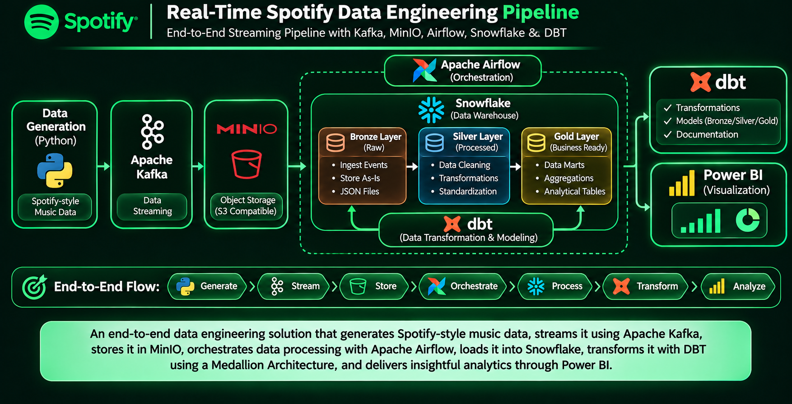
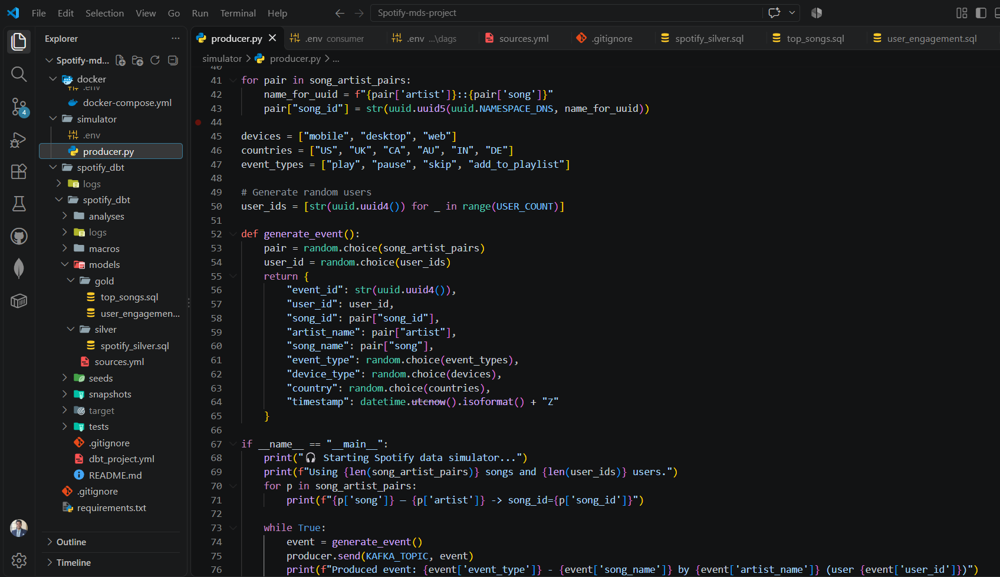
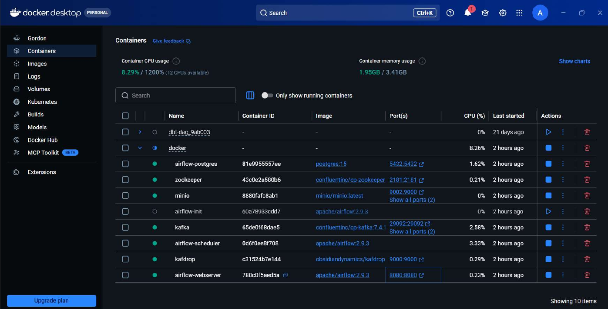
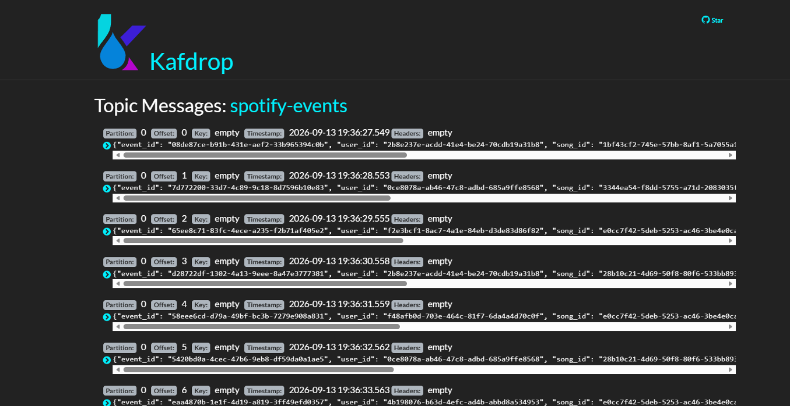
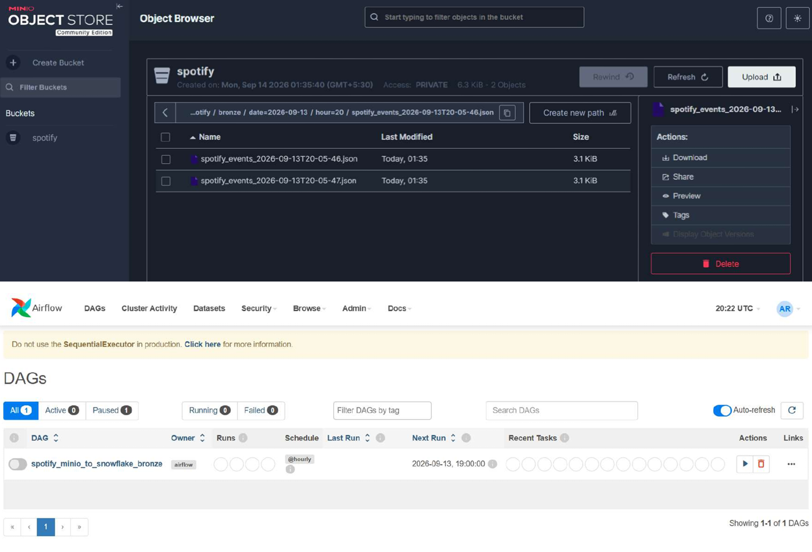

# Real-Time Spotify Data Streaming & Analytics Pipeline

<p align="center">
  <strong>Data Engineering | Streaming | Cloud Data Warehouse | Analytics</strong>
</p>

<p align="center">
  
  
  
  
  
  
  
  
</p>

## Project Overview

An end-to-end **Spotify Data Streaming and Analytics Pipeline** built using Python, Apache Kafka, MinIO, Apache Airflow, Snowflake, DBT, and Power BI.

The project demonstrates a streaming-oriented data engineering workflow that generates Spotify-style music data, processes and transfers data through a distributed pipeline, stores it in Snowflake, and transforms it into analytical datasets for business intelligence.

It combines event streaming, object storage, workflow orchestration, cloud data warehousing, data transformation, and visualization into an integrated data engineering solution.

## Business Scenario

Music streaming platforms generate large volumes of data related to tracks, artists, albums, and listening activity.

This project demonstrates how a data engineering pipeline can process music-related datasets and prepare them for analytical exploration.

The solution focuses on:

- Generating music-related data for pipeline processing.
- Handling data ingestion through Apache Kafka.
- Storing intermediate data in MinIO object storage.
- Orchestrating data movement using Apache Airflow.
- Loading structured data into Snowflake.
- Transforming raw data into analytical models using DBT.
- Building Power BI dashboards to explore music-related insights.

## Architecture

The pipeline combines streaming, object storage, orchestration, cloud warehousing, and analytics technologies.

### Data Pipeline Workflow

The following architecture illustrates the end-to-end flow from data generation and streaming to warehouse transformation and business intelligence.

<p align="center">
  
</p>

### Pipeline Stages

| Stage | Technology | Responsibility |
|---|---|---|
| Data Generation | Python | Generate Spotify-style music data |
| Streaming | Apache Kafka | Handle streaming data flow |
| Object Storage | MinIO | Store intermediate data |
| Orchestration | Apache Airflow | Coordinate data movement and pipeline tasks |
| Data Warehouse | Snowflake | Store data for analytical processing |
| Transformation | DBT | Build structured analytical models |
| Visualization | Power BI | Present analytical insights |
| Environment | Docker | Run containerized project services |

## Technology Stack

| Category | Technologies |
|---|---|
| Programming | Python, SQL |
| Streaming | Apache Kafka |
| Object Storage | MinIO |
| Orchestration | Apache Airflow |
| Data Warehouse | Snowflake |
| Data Transformation | DBT |
| Visualization | Power BI |
| Containerization | Docker, Docker Compose |
| Development Tools | VS Code, Git, GitHub |

## Key Engineering Implementations

### 1. Data Generation & Streaming

- Developed Python-based data generation to simulate Spotify-style music data.
- Configured Apache Kafka for streaming data ingestion.
- Used Kafka as the messaging layer for handling incoming data.
- Containerized the supporting services using Docker.

Python Data Generation Implementation
The Python producer script simulates Spotify-style listening events by generating user IDs, song and artist information, event types, device types, countries, and timestamps before publishing events to Kafka.

### 1. Python Data Generation
<p align="center">
  
</p>

Docker Container Environment
Docker Compose is used to configure and run the project's supporting services, including Kafka, Zookeeper, MinIO, and Apache Airflow.

### 2. Docker Environment
<p align="center">
  
</p>

### 2. Object Storage with MinIO

- Integrated MinIO as an S3-compatible object storage layer.
- Used MinIO to store intermediate data generated through the ingestion workflow.
- Organized the data flow between streaming and warehouse components.

Kafka Streaming Messages
The Kafdrop interface provides visibility into messages published to the spotify-events Kafka topic, demonstrating the flow of generated event records through the streaming layer.

### 3. Kafka Streaming
<p align="center">
  
</p>

### 3. Workflow Orchestration with Apache Airflow

- Configured Apache Airflow to orchestrate the data pipeline.
- Developed DAG-based workflows to coordinate data movement from MinIO to Snowflake.
- Organized pipeline tasks to support repeatable execution and monitoring.

MinIO Storage & Airflow DAG
The MinIO object browser shows generated JSON event files stored in the Spotify bucket, while the Airflow interface displays the DAG configured to orchestrate the MinIO-to-Snowflake ingestion workflow.

### 4. MinIO Storage & Airflow Orchestration
<p align="center">
  
</p>

### 4. Snowflake Data Warehouse

- Integrated Snowflake as the central analytical data warehouse.
- Loaded processed source data into Snowflake.
- Prepared warehouse data for downstream transformation and analysis.

### 5. Data Transformation with DBT

- Configured DBT to connect with Snowflake.
- Developed SQL-based transformation models.
- Organized data transformation into structured analytical layers.
- Built Silver and Gold transformation models for downstream analysis.

### 6. Business Intelligence with Power BI

- Connected Power BI with Snowflake.
- Prepared analytical datasets for reporting.
- Developed visualizations to explore music-related data and trends.

## Project Structure

The repository contains the application code, container configuration, orchestration workflows, transformation models, and supporting documentation.

```text
Spotify-Data-Engineering-Pipeline/
│
├── dags/
│   └── airflow_pipeline.py
│
├── src/
│   ├── data_generation/
│   └── kafka/
│
├── dbt_project/
│   ├── models/
│   ├── macros/
│   ├── tests/
│   └── dbt_project.yml
│
├── docker/
│
├── config/
│
├── assets/
│   └── spotify-data-engineering-workflow.png
│
├── docker-compose.yml
├── requirements.txt
└── README.md
```

*Note: This is an illustrative structure. Keep the actual folder and file names from your repository rather than creating directories that do not exist.*

## Execution Workflow

1. **Environment Setup:** Configure Docker and the required project services.
2. **Data Generation:** Generate Spotify-style music data using Python.
3. **Streaming:** Send generated data through Apache Kafka.
4. **Storage:** Store intermediate data in MinIO.
5. **Orchestration:** Use Apache Airflow DAGs to coordinate the MinIO-to-Snowflake workflow.
6. **Warehouse Loading:** Load data into Snowflake.
7. **Transformation:** Execute DBT models to prepare Silver and Gold analytical datasets.
8. **Visualization:** Connect Power BI to Snowflake and explore the transformed data.

## How to Explore the Project

- **GitHub:** Browse the source code, Docker configuration, Airflow DAGs, and DBT models.
- **VS Code:** Review and modify the Python, SQL, and configuration files.
- **Docker:** Run and manage the containerized project services.
- **Apache Airflow:** Inspect DAGs and pipeline execution.
- **Snowflake:** Explore the loaded datasets and transformed models.
- **Power BI:** Review the final analytical dashboards.

To execute the complete pipeline, configure the required service credentials, Snowflake connection, and local Docker environment.

## Key Concepts Demonstrated

- Data Engineering and Streaming Pipelines
- Apache Kafka
- Object Storage with MinIO
- Workflow Orchestration with Apache Airflow
- Snowflake Data Warehousing
- DBT Transformations and Data Modeling
- SQL-Based Analytics
- Docker and Containerization
- Business Intelligence with Power BI
- End-to-End Data Pipeline Integration

## Future Enhancements

- Implement automated pipeline scheduling and monitoring.
- Add data quality checks and validation.
- Improve error handling and pipeline recovery.
- Extend the data models with additional music analytics.
- Enhance dashboard interactivity and analytical reporting.

## Author

**Amash Riaz**

Computer Science Graduate | Aspiring Data Engineer

- **GitHub:** [Amashriaz1103](https://github.com/Amashriaz1103)
- **LinkedIn:** [Amash Riaz](https://www.linkedin.com/in/amash-riaz/)

---

<p align="center">
  <strong>Built to demonstrate practical Data Engineering skills across streaming, orchestration, cloud warehousing, and analytics.</strong>
</p>
